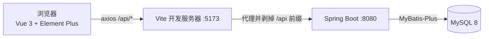

# MyWiki —— 个人 Wiki / 博客系统

全栈个人博客：文章（含草稿/发布）、分类、标签、评论、JWT 登录。后端 TDD 开发，接口测试与 e2e 测试覆盖核心业务规则，CI 双 job 自动回归。

## 技术栈

| 层 | 选型 |
|---|---|
| 前端 | Vue 3.5 · Element Plus 2.14 · Pinia · Vue Router · Vite 8 · TypeScript · axios |
| 后端 | Spring Boot 3.5 · MyBatis-Plus 3.5 · JWT (jjwt) · BCrypt · Bean Validation（Java 17） |
| 接口文档 | OpenAPI 3（springdoc 2.10）+ Swagger UI（自动扫描 Controller 生成，零漂移） |
| 数据库 | MySQL 8（utf8mb4） |
| 测试 | JUnit 5 + Spring Boot Test + MockMvc + Testcontainers（后端）· Playwright（e2e） |
| 工程 | GitHub Actions（push 触发，e2e / backend-test 双 job 并行） |

## 架构



- 前端所有请求走 `/api` 前缀，由 Vite 代理转发给后端并**剥掉前缀**；后端接口路径本身没有 `/api`
- 鉴权：JWT（Bearer Token），`JwtInterceptor` 统一解析；业务错误用 `ErrorCode` 映射 HTTP 状态（400/401/403/404）
- 响应统一包装为 `Result { code, message, data }`，`code = 0` 为成功

## 功能

- **用户**：注册 / 登录（JWT）；游客可浏览已发布内容
- **文章**：增删改查；关键字 / 分类 / 标签筛选；分页；“我的文章”筛选
- **草稿 / 发布**：两态模型；草稿仅作者本人可见（列表、详情、评论均按“不存在”处理）；编辑已发布文章保持发布
- **分类 / 标签**：管理页（仅 ADMIN）；重名拒绝；被文章占用时不可删除
- **评论**：发表 / 删除（评论作者或文章作者可删）；分页（默认每页 10 条，时间倒序）；批量回填用户名（避免 N+1）

## 目录结构

```
backend/
  src/main/java/com/mywiki/backend/
    controller/  service/  mapper/  entity/  dto/  vo/
    config/  interceptor/  resolver/  exception/  common/
  sql/
    schema.sql          # 表结构唯一真相（e2e 与后端测试共用）
    seed.sql            # e2e 种子数据
    reset-test-db.sh    # 重置 e2e 测试库
  src/test/             # 接口测试（BaseApiTest + Testcontainers）
frontend/
  src/                  # views / api / stores / router
  e2e/                  # Playwright 测试（fixtures / helpers / *.spec.ts）
.github/workflows/      # CI（e2e 与 backend-test 并行）
```

## 快速开始

前置：Java 17、Node 22+、pnpm、Docker。

```bash
# 1. 启动 MySQL（本机 Docker）
docker run -d --name mysql8 -e MYSQL_ROOT_PASSWORD=123456 -p 3306:3306 mysql:8.0

# 2. 建库 + 建表（mysql 客户端需指定 utf8mb4，否则中文会双重编码）
docker exec -i mysql8 mysql -uroot -p123456 \
  -e "CREATE DATABASE IF NOT EXISTS mywiki CHARACTER SET utf8mb4 COLLATE utf8mb4_0900_ai_ci"
docker exec -i mysql8 mysql -uroot -p123456 --default-character-set=utf8mb4 \
  mywiki < backend/sql/schema.sql

# 3. 启动后端（连接 mywiki 库）
cd backend && ./mvnw spring-boot:run

# 4. 启动前端（另开终端）
cd frontend && pnpm install && pnpm dev
```

访问 http://localhost:5173 ，注册账号即可使用。

接口文档：后端启动后打开 http://localhost:8080/swagger-ui.html —— 自动扫描 Controller 生成的 OpenAPI 文档，右上角 **Authorize** 填入登录接口返回的 token 后可直接调试受保护接口。

## 测试

```bash
# 接口测试（49 个）：Testcontainers 自动拉起一次性 MySQL 8，用完即毁
cd backend && ./mvnw test

# e2e（13 个）：自动重置测试库 → 以 test profile 启动后端 → 启动 Vite → 无头浏览器
cd frontend && pnpm exec playwright test
```

- 后端测试：JUnit 5 + `@SpringBootTest` + MockMvc；`BaseApiTest` 提供单例 Testcontainers 容器与登录辅助
- e2e：Playwright；每个测试前通过 `reset-test-db.sh` 重置 `mywiki_test`，测试互不依赖；失败自动留存截图 / trace / aria 快照
- 开发流程遵循“契约先行 → 写测试（红）→ 最小实现（绿）→ 前端 + e2e → CI 复核”

## CI

`.github/workflows/e2e.yml`：push 触发两个并行 job——

- `e2e`：MySQL service 容器 + 安装客户端 → Playwright 全量 e2e
- `backend-test`：Testcontainers 自起 MySQL → `./mvnw test`

## 约定

- 后端路径无 `/api` 前缀（curl 直连后端时注意）
- 错误码：`@Valid` 校验失败 → 400 + code 10002；业务错误按 `ErrorCode` 自带状态码；登录失败 400（10004）、未登录 401（10006）、无权限 403、不存在 404
- 文章状态两态 `DRAFT` / `PUBLISHED`；草稿对非作者按 404 处理（详情与评论一致）
- commit message 中文，前缀式：【add】【fix】【test】
